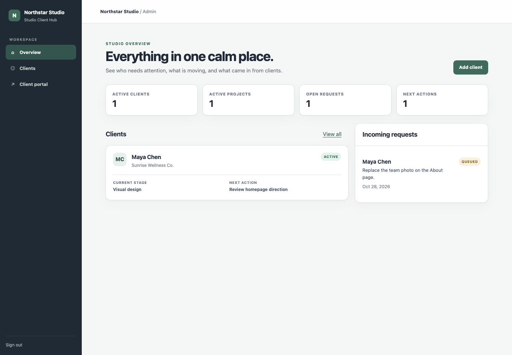
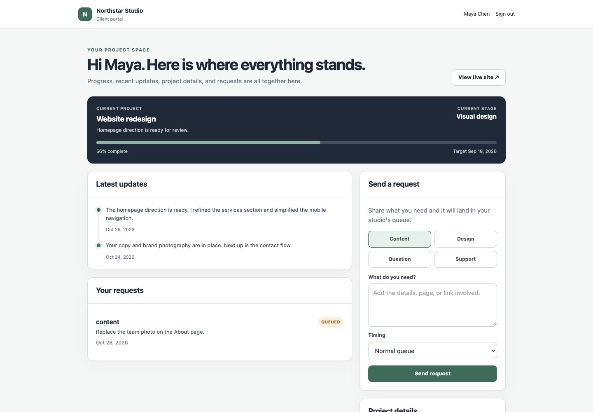

# Studio Client Hub

[](https://github.com/kickstartcreatives/studio-client-hub/actions/workflows/ci.yml)
[](LICENSE)

A self-hosted CRM and client portal for independent web designers. Keep track of client
work in the admin dashboard, and give each client a place to check progress or send a
request.

It runs on one Cloudflare Worker and one D1 database. You can use it on its own, without
connecting a proposal app, website monitor or project tracker.

[Use this template](https://github.com/new?template_name=studio-client-hub&template_owner=kickstartcreatives)
to make your own copy, or clone it to try locally. You don't need a Cloudflare account or
email service for the local demo. To put it online for clients, you'll need your own
Cloudflare and Resend accounts.



<details>
<summary>See the client portal</summary>



</details>

## What you can do

- See active clients and projects, open requests, and what needs attention next.
- Open a client's record (Client 360) to see their engagement, agreed rate and project history.
- Update project stages, progress, target dates and the current focus.
- Post client updates and record agreements.
- Let clients sign in with a single-use email link and submit requests.
- Change a request's status as you work through it.
- Use "Open as client" from the admin to check their portal.

A fictional client is included so you can try it before adding your own records. Both
sides work on desktop and mobile. Client queries are scoped to the signed-in client;
the app also includes CSRF checks, secure cookies, login limits and escaped output.

## Stack

- Cloudflare Workers
- Cloudflare D1 (SQLite)
- Resend for email delivery (not needed for the local demo)
- Plain JavaScript and server-rendered HTML

There is no framework, build-time CSS system, or client-side JavaScript dependency.

## Quick start

Use Node.js 24 LTS (recommended) or 22, plus npm. The minimum supported version is
Node.js 22, matching [Wrangler's requirements](https://developers.cloudflare.com/workers/wrangler/install-and-update/).
If you use nvm, run `nvm use` in this directory.

```bash
git clone https://github.com/kickstartcreatives/studio-client-hub.git
cd studio-client-hub
npm ci
npm run setup
npm run db:migrate:local
npm run db:seed:local
npm run dev
```

Open `http://localhost:8787/admin/login` and use the generated `ADMIN_PASSWORD` from
`.dev.vars`. The setup command generates unique credentials and leaves an existing file
alone. The values in `.dev.vars.example` are placeholders, so copying that file without
replacing them won't work. Git ignores your local database and credentials.

To try the client side, open `http://localhost:8787/portal`, enter
`maya@example.com`, and use the local preview link shown on the page. Preview links are
shown only on localhost when `DEV_SHOW_MAGIC_LINKS=1`; that setting should never be
configured as a deployed Worker variable.

## Make it yours

Set your studio name and email addresses in `wrangler.jsonc`:

- `STUDIO_NAME`
- `SUPPORT_EMAIL`
- `EMAIL_FROM`

Colors, fonts and layout rules are in `src/ui.js`. Start with these CSS variables:

- `--accent: #3f6b5b` (muted evergreen)
- `--sidebar: #202a35` (dark slate)
- `--canvas: #f5f7f6` (soft neutral)
- `--font: Inter, ui-sans-serif, ...` (system font fallbacks)

The template uses a generic font stack and includes no private font files or studio brand assets.

## Deploy to Cloudflare

1. Sign in to Wrangler:

   ```bash
   npx wrangler login
   ```

2. Create a D1 database:

   ```bash
   npx wrangler d1 create studio-client-hub
   ```

3. Replace the placeholder `database_id` in `wrangler.jsonc` with the ID returned by
   Cloudflare.

4. Set production secrets. Use unique random values of at least 32 characters for the
   two signing secrets and a strong admin password of at least 12 characters.

   ```bash
   npx wrangler secret put ADMIN_PASSWORD
   npx wrangler secret put SESSION_SECRET
   npx wrangler secret put MAGIC_LINK_SECRET
   npx wrangler secret put RESEND_API_KEY
   ```

5. Set `EMAIL_FROM` to a verified Resend sender. Client sign-in emails need both a valid
   Resend key and a verified sender to work online.

6. Apply the schema and deploy:

   ```bash
   npx wrangler d1 migrations apply studio-client-hub --remote
   npx wrangler deploy
   ```

The seed adds the fictional Sunrise Wellness client. Leave it out of production unless
you want that demo record there too.

## Run the checks

```bash
npm run check
```

This builds the Worker, runs the tests and checks dependencies for known vulnerabilities.
The tests use the Worker runtime and D1 to check sign-in, client isolation and form
submissions, including attempts that should be rejected. They also cover record edits,
output escaping and the accent color.

GitHub Actions runs the checks on Node.js 22 and 24 for every push and pull request, and
once a week. It doesn't deploy the app.

## Contributing and maintenance

[CONTRIBUTING.md](CONTRIBUTING.md) explains where the code lives and how to submit a
change. [Report a bug](https://github.com/kickstartcreatives/studio-client-hub/issues/new?template=bug_report.yml)
with steps to reproduce it, using fictional data. Report security problems
[privately](SECURITY.md#reporting-a-vulnerability).

Dependabot opens pull requests for dependency and GitHub Actions updates each week.
Review and test them before updating a deployed copy. You'll host and maintain your own
installation; there's no hosted service or guaranteed support response time.

## Troubleshooting

| Symptom | What to check |
| --- | --- |
| `Setup incomplete` | Run `npm run setup` if `.dev.vars` is missing. Otherwise replace placeholders and check secret lengths; signing secrets must differ. |
| `no such table` | Run `npm run db:migrate:local`. Remote deployments need the separate `--remote` migration step. |
| No demo client | Run `npm run db:seed:local`; the seed can be run again without duplicating its records. |
| No local sign-in link | Use `localhost` or `127.0.0.1`, check `DEV_SHOW_MAGIC_LINKS=1`, and use `maya@example.com`. Repeated attempts pause links for 15 minutes. |
| No deployed email | Check the Resend key, verified `EMAIL_FROM` domain and provider delivery logs. The sign-in page does not reveal whether an address is registered. |

## What's not included

There are no file uploads, invoices, automatic website-health checks, multi-studio accounts
or CRM imports. Adding those would mean more services to configure and maintain. If you
need them, they can be built as optional additions.

[The review notes](docs/AUDIT.md) cover what was tested and what wasn't.
[SECURITY.md](SECURITY.md) explains deployment precautions and session handling.

## License

MIT. You can use, adapt and redistribute the code, including commercially, while keeping
the license and copyright notice. See [LICENSE](LICENSE). Third-party dependencies retain
their own licenses. `private: true` in `package.json` only prevents accidental npm publishing;
it does not make this GitHub repository private.
